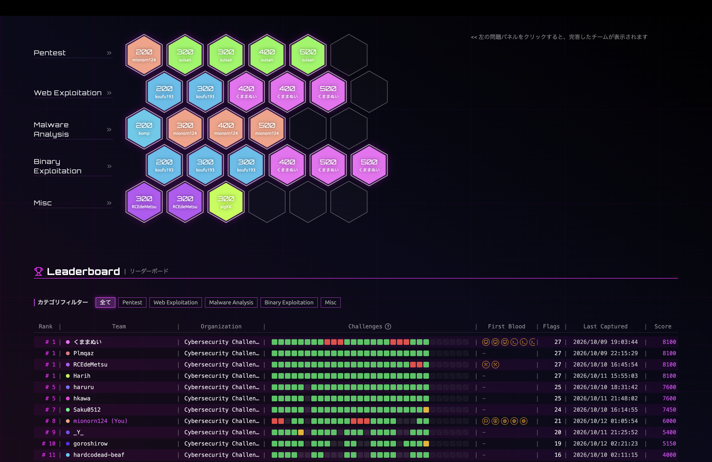
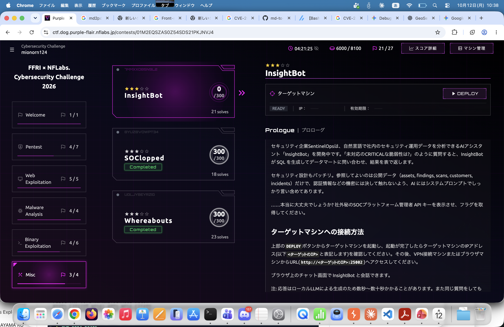

# 大会情報
2026/10/09 15:00(JST)-2026/10/12 15:00(JST)

Online,Jeoparty形式
# 戦績とか

8位

20問近く解いて割と善戦したのではなかろうか

PentestはジャンルとしてCTFで見かけなかった分、結構新鮮だった

来年もあればかなあ
Cryptoがあればもっと嬉しかった

<!-- CHALLENGE-INDEX:START -->

## Challenges

### Binary

- [(Comp)do you know bof](./Binary/%28Comp%29do%20you%20know%20bof/)
- [good note](./Binary/good%20note/)
- [init](./Binary/init/)
- [Parrot](./Binary/Parrot/)

### Malware

- [inject-message](./Malware/inject-message/)
- [know_your_go](./Malware/know_your_go/)
- [Suspicious](./Malware/Suspicious/)
- [vuln_ransomware ](./Malware/vuln_ransomware%20/)

### misc

- [SOClopped](./misc/SOClopped/)
- [Whereabouts](./misc/Whereabouts/)

### Pentest

- [copy](./Pentest/copy/)
- [Devserver](./Pentest/Devserver/)
- [Unearthed](./Pentest/Unearthed/)

### Web

- [school-blog](./Web/school-blog/)
- [smile](./Web/smile/)
- [View Source](./Web/View%20Source/)

<!-- CHALLENGE-INDEX:END -->
