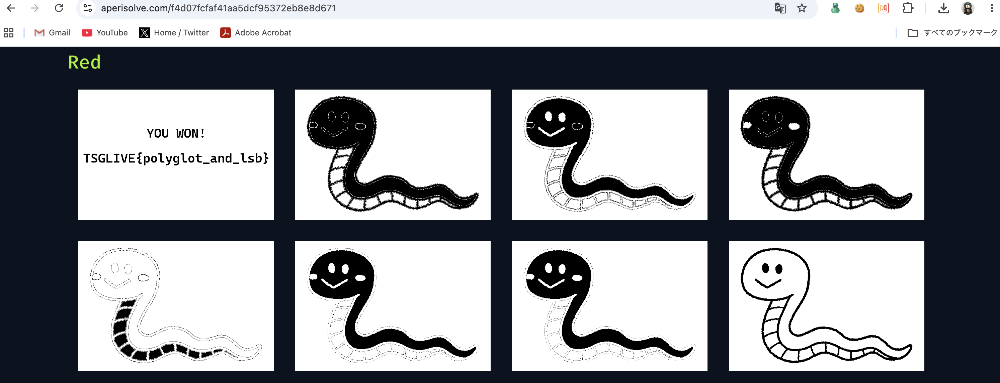

# cold-blooded

unzipして投げてaperi使うだけ

尻尾の先っぽとか赤いでまあaperi solveで解決できるかと思った


```
╭─ /Users/mionorn124/Downloads/TSG LIVE! CTF/Misc/cold-blooded
╰─ (*'-') < unzip chal.png
Archive:  chal.png
replace thaw.py? [y]es, [n]o, [A]ll, [N]one, [r]ename: y
  inflating: thaw.py 
╭─ /Users/mionorn124/Downloads/TSG LIVE! CTF/Misc/cold-blooded
╰─ (*'-') < python3 thaw.py chal.png  
凍ったヘビを溶かすことはできた。しかし、赤い血が通ったのは、尻尾のいちばん先っぽだけだった。
╭─ /Users/mionorn124/Downloads/TSG LIVE! CTF/Misc/cold-blooded
╰─ (*'-') < python3 thaw.py chal.png

```


# flag
```
TSGLIVE{polyglot_and_lsb}
```