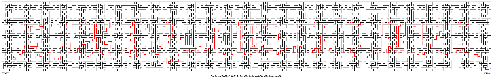

# how to solve
It was too much of a hassle, so use [solver.py](https://handasse.blogspot.com/2009/10/python-2.html)

But, it is not solved, so I wrote fixed version.

```
python3 maze_solver_fixed.py d4rkmaze.png \
  -s 20 441 \
  -g 3101 441 \
  --bounds 12 12 3106 455 \
  -o solve.png
```

# flag
d4rk{HOW_WAS_THE_MAZE}

