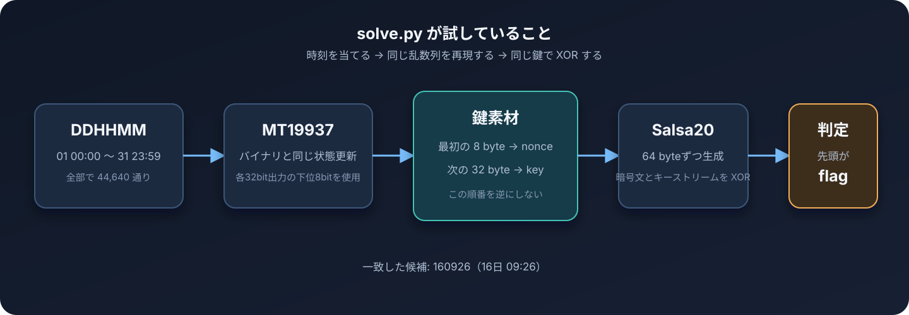

# vuln_ransomware


## まず結論

`ransomware.exe` は Salsa20 で `flag.txt` を暗号化している。ただし、鍵と nonce の生成に使う MT19937 の seed が「日・時・分」しか持っていない。候補数は最大でも

```text
31 × 24 × 60 = 44,640 通り
```

しかないので、あり得る時刻を全部試せば復号できる。

最終的に当たった seed は `160926`、つまり **16日 09:26** だった。復号結果は次の通り。

```text
flag{pr3d1ct4bl3_s33d_br34ks_crypt0}
```

## 配布ファイルを眺める

最初にファイルの種類と、埋め込まれている文字列を確認した。

```bash
$ file ransomware.exe flag.txt
ransomware.exe: PE32+ executable (console) x86-64, for MS Windows
flag.txt:       data

$ strings -a -n 4 ransomware.exe
VMware
VBox
flag.txt
expand 32-byte k
...
```

`flag.txt` は38バイトしかなく、中身も普通のテキストではなかった。

```bash
$ xxd -g 1 flag.txt
00000000: 1b 78 67 fe 8b 6b f2 7d 02 01 9a 20 6c 48 b2 1c
00000010: d0 4a 1f 44 5a 7d 4b b2 5a b0 93 6f b4 5b 08 d6
00000020: 8a 05 f5 30 86 f0
```

この時点で一番気になったのは `expand 32-byte k` だった。これは Salsa20 / ChaCha 系で使われる定数で、32バイト鍵を使っている可能性がかなり高い。`VMware` や `VBox` も見えるので、先頭に簡単な仮想環境チェックがありそうだとも分かる。

なお、配布物とはいえ名前は ransomware なので、手元の普段使いの Windows 環境でそのまま実行するのは避けた。今回は静的解析だけで必要な情報が全部取れる。

## Ghidra で処理を追う

Ghidra に `ransomware.exe` を読み込ませて Auto Analyze をかけた。シンボルはほぼ残っていないので、最初は `flag.txt` の文字列を開き、そこへの XREF から呼び出し元を辿った。

中心になっていたのは `FUN_140001850` で、ここを仮に `main` として読んだ。大まかな流れはこうなっていた。

1. CPUID で仮想環境らしき文字列を確認する
2. 現在時刻を `_time64` と `_localtime64_s` で取得する
3. 日・時・分から整数を1個作る
4. その整数で MT19937 を初期化する
5. MT19937 の出力から nonce を8バイト、鍵を32バイト作る
6. `flag.txt` を読み込み、Salsa20 のキーストリームと XOR する
7. 結果を同じ `flag.txt` に書き戻す

先頭の仮想環境チェックでは、CPUID の hypervisor vendor に `VMware`、`VBox`、`TCG`、`KVM` のどれかが含まれていると、そのまま処理を終了する。少しそれっぽい妨害ではあるが、今回欲しいのは暗号処理なので深追いはしなかった。

### seed の作り方

Ghidra の Decompiler では、時刻を取った直後に次の計算が見えた。

```c
seed = (tm_mday * 100 + tm_hour) * 100 + tm_min;
```

要するに `DDHHMM` である。例えば16日の09:26なら `160926` になる。

月、年、秒が一切入っていないのが致命的だった。日付を1〜31、時を0〜23、分を0〜59で回しても44,640通りしかない。暗号鍵を総当たりする感覚ではなく、短い暗証番号を全部試すくらいの量で済む。

## 乱数生成は MT19937

seed の直後には、次のような定数と処理が並んでいた。

```text
状態配列の要素数: 624 (0x270)
初期化の乗数:     0x6c078965
twist の定数:     0x9908b0df
参照位置:         397
```

ここまで揃えば MT19937 と見てよい。`FUN_140001d10` には twist と tempering がまとまっていた。Ghidra の出力はコンパイラ最適化の影響で少し崩れて見えるが、整理すると普通の MT19937 だった。

```python
state[0] = seed
for i in range(1, 624):
    state[i] = (
        0x6C078965 * (state[i - 1] ^ (state[i - 1] >> 30)) + i
    ) & 0xFFFFFFFF
```

出力時の tempering も次の形になる。

```python
y ^= y >> 11
y ^= (y << 7) & 0x9D2C5680
y ^= (y << 15) & 0xEFC60000
y ^= y >> 18
```

ここで少し注意が必要だった。Python の `random` も内部では MT19937 を使っているが、seed の展開方法まで同じとは限らない。そのため `random.seed(seed)` に丸投げせず、バイナリにある初期化・twist・tempering をそのまま `MT19937` クラスとして書き直した。

### nonce と key を取る順番

乱数の32ビット出力は、そのまま全部使われるわけではなかった。毎回、下位8ビットだけを1バイトとして取り出している。

```python
nonce = bytes(generator.getrandbits32() & 0xFF for _ in range(8))
key   = bytes(generator.getrandbits32() & 0xFF for _ in range(32))
```

順番は **nonce が先、key が後**。ここを逆にすると当然まったく復号できない。

Ghidra 上では、最初の8回分が `main` にインライン展開され、その後の32回は `FUN_140001d10` の呼び出しになっていた。そのせいで最初は別の乱数処理が2種類あるようにも見えたが、状態配列と index を追うと、同じ MT19937 から続けて40バイト取っているだけだった。

## Salsa20 の処理を確認する

`FUN_140001000` が64バイトのキーストリームを1ブロック作る関数だった。先ほど strings で見えた `expand 32-byte k` は、リトルエンディアンの32ビット値として次の4個に分かれている。

```text
0x61707865  -> "expa"
0x3320646e  -> "nd 3"
0x79622d32  -> "2-by"
0x6b206574  -> "te k"
```

初期状態の16ワードを並べると、標準的な Salsa20 の配置になる。

```text
c0   k0   k1   k2
k3   c1   n0   n1
ctr0 ctr1 c2   k4
k5   k6   k7   c3
```

- `k0`〜`k7`: 32バイト鍵
- `n0`〜`n1`: 8バイト nonce
- `ctr0`, `ctr1`: 64ビットのブロックカウンタ
- `c0`〜`c3`: `expand 32-byte k`

ラウンド中には加算、XOR、7/9/13/18ビットの左ローテートが並ぶ。逆アセンブル結果では `ror 25` のように右ローテートで表示される箇所もあるが、32ビット値の `ROR 25` は `ROL 7` と同じである。

`solve.py` では `rol32()` を用意し、column round と row round を10回繰り返している。1周で2ラウンドなので合計20ラウンド、つまり Salsa20/20 になる。最後に変換前の state を足し戻し、リトルエンディアンで64バイトに詰めればキーストリームの完成。

もう一つの `FUN_140001660` は、その64バイトとファイル内容を XOR するだけの関数だった。64バイトごとにカウンタを1増やしている。

```python
for offset in range(0, len(output), 64):
    block = salsa20_block(key, nonce, offset // 64)
    size = min(64, len(output) - offset)
    for i in range(size):
        output[offset + i] ^= block[i]
```

Salsa20 はストリーム暗号なので、暗号化も復号も同じ XOR でよい。

```text
ciphertext = plaintext XOR keystream
plaintext  = ciphertext XOR keystream
```

## 総当たり部分

ここまで分かれば、あとは `DDHHMM` を全探索するだけだった。



`solve.py` の `recover()` では、日・時・分を三重ループで回している。

```python
for day in range(1, 32):
    for hour in range(24):
        for minute in range(60):
            seed = (day * 100 + hour) * 100 + minute
            key, nonce = material(seed)
            plaintext = crypt(ciphertext, key, nonce)
            if plaintext.startswith(b"flag"):
                return seed, key, nonce, plaintext
```

正しい seed かどうかは、復号結果が `flag` で始まるかで判定した。候補は44,640個しかなく、4バイトが偶然 `flag` に一致する可能性も十分低いので、この問題ではこれで困らない。

最適化するなら先頭4バイトだけ復号して判定してから残りを処理してもよい。ただ、暗号文自体が38バイトしかないので、毎回全部復号しても数秒で終わった。読みやすさを優先して今の形にしている。

## 実行結果

```bash
$ python3 solve.py
seed (DDHHMM): 160926
nonce: 437bfa29e884eb61
key: 71ffd150a5ed8893ee06e906c38670d7949ce32b84786f3c4e2a12fbe6b9dcb9
plaintext: flag{pr3d1ct4bl3_s33d_br34ks_crypt0}
wrote: flag.decrypted.txt
```

復号後のファイルは CRLF を含めて38バイトになっており、元の暗号文と長さも一致している。

```bash
$ xxd -g 1 flag.decrypted.txt
00000000: 66 6c 61 67 7b 70 72 33 64 31 63 74 34 62 6c 33
00000010: 5f 73 33 33 64 5f 62 72 33 34 6b 73 5f 63 72 79
00000020: 70 74 30 7d 0d 0a
```

## 詰まりやすかったところ

今回、暗号処理を丸ごと理解するより大事だったのは、Ghidra の出力から「何を同じにすれば乱数列を再現できるか」を落とさないことだった。特に次の点は間違えやすい。

- seed は UNIX 時刻ではなく `DDHHMM`
- 月・年・秒は seed に入らない
- Python 標準の `random` をそのまま使わず、バイナリと同じ MT19937 を実装する
- 乱数出力は32ビット全部ではなく下位1バイトだけ使う
- 先に nonce を8バイト、その後で key を32バイト生成する
- Salsa20 のワードはリトルエンディアン
- 32ビット加算は毎回 `& 0xFFFFFFFF` で丸める
- 64バイトごとにブロックカウンタを増やす

Salsa20 自体を破ったわけではない。十分強い暗号でも、鍵の元が44,640通りしかなければ、入口で全部試せてしまう。フラグ名の通り、`predictable seed` がそのまま敗因になっている問題だった。

