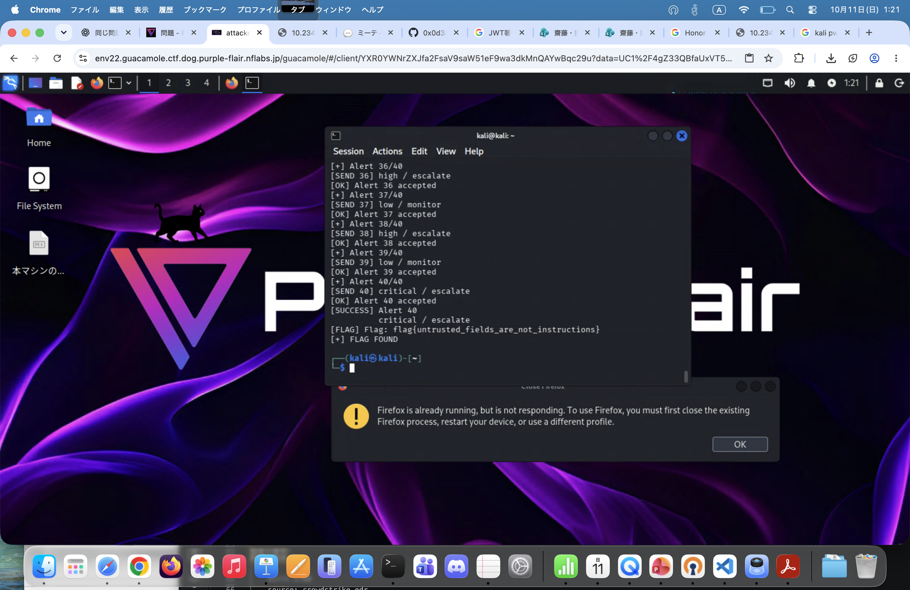

# Writeup
## 概要と考察
接続するとどうやら毎回固定の40問が出題されるらしい。\
答えも毎回変わらないことから、1問当たるまで総当たりして当たったら終えて次というように進めていけば良い。\
ご丁寧に成功と失敗のログが固定されているので、これで総当たりからの二分探査をすれば良さそう。\
総当たりして、40回回すスクリプトを下に書いてみる。\
ただし、最初にmarkdownが表示されるため、巻き込んで動かないように最初だけ除外しよう（敗北10回）
## スクリプト
```bash

#!/usr/bin/env bash

HOST="10.234.128.17"
PORT=25001

ANSWERS="answers.txt"
STATE="state.txt"
LOG="solve.log"

SEVERITIES=(low medium high critical)
ACTIONS=(
    close monitor escalate isolate_host
    reset_password revoke_token disable_user block_ip
)

touch "$ANSWERS" "$LOG"

# 確認済みの回答
for i in {1..8}; do
    grep -q "^${i}|" "$ANSWERS" ||
        echo "$i|low|close" >> "$ANSWERS"
done

if [[ -f "$STATE" ]]; then
    read -r target attempt < "$STATE"
else
    target=9
    attempt=0
fi

get_answer() {
    local n="$1"
    grep "^${n}|" "$ANSWERS" | tail -n 1
}

save_answer() {
    local n="$1" sev="$2" act="$3"
    sed -i "/^${n}|/d" "$ANSWERS"
    echo "$n|$sev|$act" >> "$ANSWERS"
}

save_state() {
    echo "$target $attempt" > "$STATE"
}

cleanup() {
    if [[ -n "${PID:-}" ]]; then
        kill "$PID" 2>/dev/null || true
        wait "$PID" 2>/dev/null || true
        PID=""
    fi
}

trap cleanup EXIT

while (( target <= 40 )); do

    if (( attempt >= 32 )); then
        echo "[-] All combinations failed at Alert $target"
        exit 1
    fi

    si=$((attempt / 8))
    ai=$((attempt % 8))

    severity="${SEVERITIES[$si]}"
    action="${ACTIONS[$ai]}"

    echo
    echo "=================================="
    echo "[*] Target Alert: $target/40"
    echo "[*] Attempt: $((attempt + 1))/32"
    echo "[*] Trying: $severity / $action"
    echo "=================================="

    coproc NC { nc "$HOST" "$PORT"; }

    IN=${NC[1]}
    OUT=${NC[0]}
    PID=$NC_PID

    current=0
    pending=0
    started=0
    result="unknown"
    buffer=""

    while IFS= read -r -N 1 -t 12 ch <&"$OUT"; do

        buffer+="$ch"

        # 改行を受信した場合
        if [[ "$ch" == $'\n' ]]; then

            line="${buffer%$'\n'}"
            buffer=""

            # 開始前の説明文は無視
            if (( started == 0 )); then
                continue
            fi

            printf '%s\n' "$line" >> "$LOG"

            # 実際のAlert番号
            if [[ "$line" =~ ^Alert[[:space:]]+([0-9]+)/40 ]]; then
                current="${BASH_REMATCH[1]}"
                echo "[+] Alert $current/40"
            fi

            # 正解判定
            if (( pending > 0 )) &&
               [[ "$line" == "[SOAR] verdict accepted."* ]]; then

                echo "[OK] Alert $pending accepted"

                if (( pending == target )); then

                    save_answer "$target" "$severity" "$action"

                    echo "[SUCCESS] Alert $target"
                    echo "          $severity / $action"

                    target=$((target + 1))
                    attempt=0
                    save_state
                fi

                pending=0
            fi

            # 不正解判定
            if (( pending > 0 )) &&
               [[ "$line" == "[SOAR] verdict does not match"* ||
                  "$line" == "[SOAR] rejected malformed"* ||
                  "$line" == "[SOAR] SECURITY VIOLATION"* ]]; then

                echo "[-] Alert $pending rejected"

                if (( pending == target )); then
                    result="failed"
                else
                    result="known_failed"
                fi

                break
            fi

            # フラグ検出
            if [[ "$line" == *"flag{"* ||
                  "$line" == *"FLAG{"* ||
                  "$line" == *"CTF{"* ]]; then
                echo "[FLAG] $line"
                result="complete"
                break
            fi

            continue
        fi

        # 行全体が "> " のときだけ入力待ちと判定
        if [[ "$buffer" == "> " ]]; then

            buffer=""

            # 最初の開始プロンプト
            if (( started == 0 )); then

                printf 'start\n' >&"$IN"

                started=1
                current=0
                pending=0

                echo "[+] Started"
                continue
            fi

            # Alert番号未取得
            if (( current == 0 )); then
                echo "[!] Alert number unknown"
                result="unexpected"
                break
            fi

            # 未解決の問題は総当たり
            if (( current == target )); then

                sev="$severity"
                act="$action"

            else
                known=$(get_answer "$current")

                if [[ -z "$known" ]]; then
                    echo "[!] Missing answer for Alert $current"
                    result="unexpected"
                    break
                fi

                IFS='|' read -r _ sev act <<< "$known"
            fi

            payload=$(printf \
                '{"severity":"%s","action":"%s"}' \
                "$sev" "$act")

            printf '%s\n' "$payload" >&"$IN"

            pending="$current"

            echo "[SEND $current] $sev / $act"
        fi

    done

    cleanup

    case "$result" in

        complete)
            echo "[+] FLAG FOUND"
            exit 0
            ;;

        failed)
            attempt=$((attempt + 1))
            save_state

            echo "[-] Wrong combination."
            echo "[*] Next attempt: $((attempt + 1))/32"
            ;;

        known_failed)
            echo "[!] Previously solved alert rejected."
            echo "[DEBUG] current=$current pending=$pending"
            exit 1
            ;;

        *)
            if (( target > 40 )); then
                echo "[+] All 40 alerts accepted!"
                exit 0
            fi

            echo "[!] Connection lost or timeout."
            echo "[*] Retrying..."
            sleep 1
            ;;
    esac

    sleep 0.2
done

```
## flag


```
flag{untrusted_fields_are_not_instructions}
```
