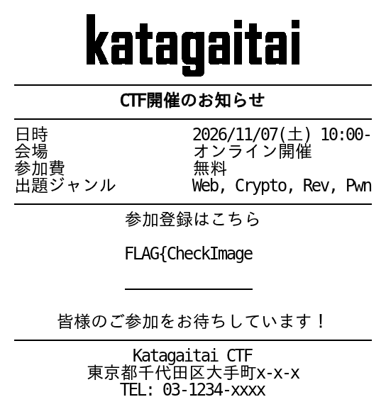

# Writeup
どうやらflagを含む出力は全て弾かれるらしい

もしかしてflagを断片的に取り出せばチェッカーは認識しないのでは？

切り出しをやってみる
```code
{text:nowrap}
{width:10}
${FLAG}
```


いけそうだな

```code
{text:nowrap}
{width:15}
${FLAG}
```



長いな...


ここまでで止まってしまった...

guessするか

どうやら二文字か三文字ラストで途切れそうなのでそれで終わる単語を考える

leet未使用っぽいのでPix->Pixel?

submitするとあってるらしい


# flag
```
FLAG{CheckImagePixel}
```